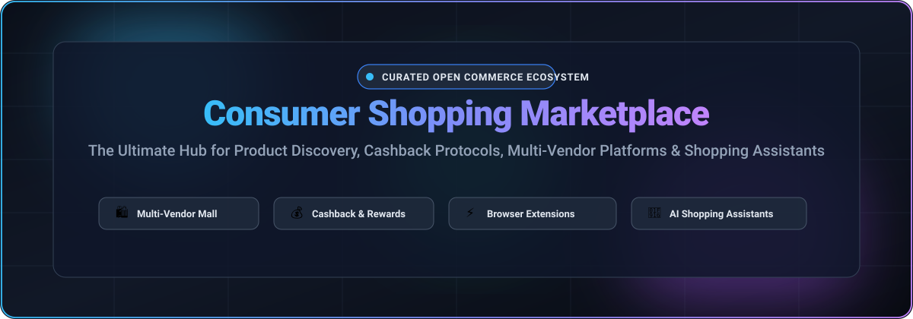

# Awesome Consumer Shopping Marketplace 🛍️

<div align="center">

<a href="https://github.com/ishandutta2007/Awesome-Awesome-Awesome"></a><a href="https://discord.gg/jc4xtF58Ve"></a>
<a href="https://github.com/ishandutta2007/Awesome-Consumer-Shopping-Marketplace/stargazers"></a>
<a href="https://github.com/ishandutta2007/Awesome-Consumer-Shopping-Marketplace/network/members"></a>
<a href="https://github.com/ishandutta2007/Awesome-Consumer-Shopping-Marketplace/issues"></a>
<a href="https://github.com/ishandutta2007/Awesome-Consumer-Shopping-Marketplace/blob/main/LICENSE"></a>
<a href="https://github.com/ishandutta2007"></a>

<br/>

<a href="#readme">
  
</a>

<p align="center">
  <strong>🌟 Curated List of SaaS Products &amp; Open-Source Projects for Consumer Shopping Marketplaces 🌟</strong>
  <br />
  <em>Focused on Product Discovery, Multi-Vendor Platforms, Cashback Protocols, Shopping Assistants &amp; Social Commerce</em>
  <br />
  <strong>Last updated: October 2026</strong>
</p>

</div>

---

## 📖 Overview &amp; Ecosystem Scope

This repository provides an authoritative, SEO-indexed, curated catalog of notable **SaaS platforms** and **open-source software repositories** powering modern **Consumer Shopping Marketplaces**. Whether you are an engineer building a custom multi-vendor commerce app, a brand setting up affiliate cashback rewards, or a shopper evaluating coupon assistants, this directory indexes both market-leading commercial solutions and production-ready self-hosted alternatives.

- **SaaS Ecosystem Giants**: Shop App (Shopify), Amazon Shopping, Google Shopping, Klarna, Honey (PayPal), LTK, Rakuten, Fetch Rewards, Shopkick, and Lyst.
- **Open-Source Infrastructure**: Headless e-commerce engines, modular B2B2C marketplace frameworks, coupon browser extensions, credit card reward optimizers, and decentralized affiliate cashback protocols.

> [!NOTE]
> **Open-Source Reality Check**: Full-blown commercial consumer shopping marketplaces rely heavily on proprietary multi-billion dollar retailer networks, affiliate aggregators, and massive multi-million SKU product catalogs. Open-source solutions provide the modular architectural foundations—such as backend commerce APIs, multi-vendor dashboards, checkout flows, and browser extensions—upon which custom shopping experiences and rewards programs are constructed.

---

## 📑 Table of Contents

- [📊 Sector Overview &amp; Market Dynamics](#-sector-overview--market-dynamics)
- [☁️ SaaS &amp; Hosted Platforms](#️-saas--hosted-platforms)
- [💻 Open-Source GitHub Projects](#-open-source-github-projects)
- [🏗️ Architectural Stacks &amp; Frameworks](#️-architectural-stacks--frameworks)
- [🤝 How to Contribute](#-how-to-contribute)
- [💖 Support &amp; Sponsorship](#-support--sponsorship)
- [📈 Star History](#--star-history)
- [⚖️ Disclaimer &amp; Privacy Notes](#️-disclaimer--privacy-notes)

---

## 📊 Sector Overview &amp; Market Dynamics

The global retail e-commerce and consumer shopping market is estimated at **$6.88T–$7.4T** (with overall digital commerce exceeding **$25T+**). The sector exhibits a **barbell concentration dynamic**: core general merchandise discovery and checkout are heavily concentrated ("winner-take-all/winner-take-most" led by titans like Alphabet/Google, Amazon, and Shopify), while ancillary shopping discovery, creator-led social commerce (LTK), and affiliate/receipt rewards (Rakuten, Fetch) remain moderately fragmented niches driven by specialized loyalty programs and creator networks.

---

## ☁️ SaaS &amp; Hosted Platforms

| Platform | Valuation / Revenue | Pricing | Free Tier Limits | Description & Best For |
| :--- | :--- | :--- | :--- | :--- |
| **[Google Shopping](https://shopping.google.com/)** | ~$3.8T Market Cap (Alphabet) / $350B+ Revenue | Free for shoppers; Paid ads via Google Ads from $0.01/click (Free merchant listings via Merchant Center) | Free forever for shoppers (unlimited search & comparison); Free organic Merchant Center product listings | Product search and comparison engine aggregating millions of merchants. **Best for**: Shoppers comparing prices across web retailers. |
| **[Amazon Shopping](https://www.amazon.com/)** | ~$2.7T Market Cap / $638B+ Revenue | Free for shoppers; Prime membership starts at $14.99/mo (or $139/yr); Seller accounts from $0.99/item sold or $39.99/mo professional | Free forever for shoppers with standard shipping minimums; Optional 30-day free trial for Amazon Prime | Dominant global marketplace ecosystem with consumer checkout and fulfillment. **Best for**: Shoppers seeking vast catalog selection and fast delivery. |
| **[Shop App](https://shop.app/)** (Shopify) | ~$215B Market Cap / $8.9B+ Revenue | Free for shoppers; Merchants pay Shopify plans starting at $39/mo (Basic) | Free forever for consumers (unlimited order tracking, discovery, and Shop Pay rewards); Merchant free trial is 3 days free then $1/mo for 1st month | Integrated consumer shopping app and tracking hub across Shopify merchants. **Best for**: Unified tracking and checkout across independent brands. |
| **[Honey](https://www.joinhoney.com/)** (PayPal) | $4B Acquisition by PayPal (~$43B Market Cap / $33B Revenue) | Free for consumers; Monetized via merchant affiliate commissions | Free forever with no coupon or cashback lookup limits across all supported browser stores | Automated coupon-finding browser extension and cashback points system. **Best for**: Automated discount code application at checkout. |
| **[Klarna App](https://www.klarna.com/)** | ~$10B Valuation / $2.8B+ Revenue | Free for shoppers (0% APR on pay-in-4 plans; up to 33.99% APR on financing); Merchants pay transaction fees from 3.29% + $0.30 | Free forever for standard shopping and interest-free 4-installment payments | Buy Now, Pay Later (BNPL) shopping assistant with price alerts and flexible payments. **Best for**: Shoppers wanting split payments with price tracking. |
| **[Rakuten](https://www.rakuten.com/)** | ~$9.5B Market Cap (Rakuten Group) / ~$14B Revenue | Free for consumers; Retailers pay affiliate sales commissions | Free forever with quarterly cashback payouts (minimum $5.01 accrued balance required to trigger payout) | Affiliate cashback and rewards platform paying cash rebates on retailer purchases. **Best for**: Earning cash rebates on everyday shopping. |
| **[Fetch Rewards](https://fetchrewards.com/)** | ~$2.5B Valuation / ~$600M Revenue | Free for shoppers; Brands pay campaign and consumer engagement partnership fees | Free forever; Earn points on any physical or digital receipt (limit of 35 scanned receipts per rolling 7-day window) | Receipt-scanning gamified loyalty and rewards application. **Best for**: Earning gift cards simply by scanning everyday shopping receipts. |
| **[LTK](https://www.shopltk.com/)** | ~$2.0B Valuation / ~$5B+ GMV Facilitated | Free for shoppers; Creators apply for free (monetized via brand commission splits); Retailers pay commission contracts | Free forever for consumers to follow influencers and discover linked products | Creator-driven social shopping platform connecting shoppers with influencer curations. **Best for**: Discovering curated outfits and lifestyle products from creators. |
| **[Shopkick](https://www.shopkick.com/)** | $200M Acquisition (SK Planet / Trax) / ~$50M+ Revenue | Free for consumers; Retailers and brands pay in-store engagement fees | Free forever; Earn "kicks" points for walking into partner stores, scanning barcodes, and submitting purchase receipts | Omnichannel loyalty app rewarding consumers for physical store visits and digital browsing. **Best for**: Earning gift cards for everyday in-store and online micro-actions. |
| **[Lyst](https://www.lyst.com/)** | $154M Acquisition (by Zozo) / ~$64M Revenue | Free for shoppers; Fashion retailers pay affiliate commissions per sale | Free forever with unlimited fashion search, designer filtering, and price alerts | Luxury and high-street fashion aggregator spanning thousands of global brands. **Best for**: Comprehensive fashion item discovery across disparate luxury stores. |

---

## 💻 Open-Source GitHub Projects

The following repositories provide open-source codebases, extensions, and engines for consumer shopping, multi-vendor marketplaces, cashback rewards, and price tracking. **Sorted in descending order by GitHub_Stars ⭐**.

- ### 1. **[Medusa](https://github.com/medusajs/medusa)** [](https://github.com/medusajs/medusa/stargazers) ⚡
  **Next-generation headless commerce framework and marketplace backend** (MIT License).
  - **Features**: Highly modular commerce engine with headless architecture, multi-tenant marketplace modules, customizable promotions and coupons, flexible checkout flows, multi-currency support, and REST/GraphQL APIs.
  - **Tech stack**: Node.js, TypeScript, PostgreSQL, Redis, Next.js storefront.
  - **Deploy**: Self-hosted (Docker, Kubernetes, AWS, Railway).
  - **Best for**: Developers building custom scalable consumer shopping platforms or multi-vendor digital malls.

- ### 2. **[Bagisto](https://github.com/bagisto/bagisto)** [](https://github.com/bagisto/bagisto/stargazers) 🛒
  **Enterprise-scale open-source multi-vendor marketplace platform** (MIT License).
  - **Features**: Dedicated multi-vendor marketplace package supporting 10M+ SKUs, individual seller storefronts, customer review systems, product comparison matrix, localized multi-currency pricing, and responsive mobile PWA.
  - **Tech stack**: PHP 8.2+, Laravel, Vue.js, Tailwind CSS, MySQL.
  - **Deploy**: Self-hosted (LAMP/LEMP stack, Docker).
  - **Best for**: Operating complete multi-vendor consumer shopping portals with comprehensive seller management.

- ### 3. **[Saleor](https://github.com/saleor/saleor)** [](https://github.com/saleor/saleor/stargazers) 🛍️
  **High-performance headless GraphQL commerce & marketplace engine** (BSD-3-Clause).
  - **Features**: GraphQL-first architecture designed for multi-channel and multi-vendor retail experiences. Ultra-fast product search, complex promotional discount rules, dynamic gift cards, and global tax calculation.
  - **Tech stack**: Python 3.12+, Django, GraphQL, PostgreSQL, Next.js / React storefront.
  - **Deploy**: Docker, Kubernetes, Saleor Cloud.
  - **Best for**: Teams engineering composable high-traffic consumer shopping applications.

- ### 4. **[Spree Commerce](https://github.com/spree/spree)** [](https://github.com/spree/spree/stargazers) 💎
  **Full-featured headless and multi-vendor marketplace platform** (BSD-3-Clause).
  - **Features**: Built-in multi-vendor marketplace extension (`spree_multi_vendor`), customer wishlist management, real-time stock sync across fulfillment centers, and ready-to-run Next.js consumer storefront.
  - **Tech stack**: Ruby on Rails, TypeScript SDK, Next.js, PostgreSQL.
  - **Deploy**: Self-hosted (Docker, Heroku, AWS).
  - **Best for**: Rapidly deploying scalable DTC brands and multi-vendor consumer marketplaces.

- ### 5. **[Aimeos Laravel](https://github.com/aimeos/aimeos-laravel)** [](https://github.com/aimeos/aimeos-laravel/stargazers) 🚀
  **Ultra-fast e-commerce and scalable marketplace engine** (LGPL-3.0).
  - **Features**: Gigacommerce capability supporting 1B+ items with sub-millisecond response times, built-in multi-vendor marketplace capabilities, coupon rule systems, and complex product search filters.
  - **Tech stack**: PHP, Laravel, Elasticsearch, MySQL/PostgreSQL.
  - **Deploy**: Self-hosted (Composer, Docker).
  - **Best for**: High-throughput consumer product catalogs and mega marketplaces.

- ### 6. **[Lilishop (PickMall)](https://github.com/lilishop/lilishop)** [](https://github.com/lilishop/lilishop/stargazers) 🏢
  **Java enterprise B2B2C multi-vendor mall system** (GPL-3.0).
  - **Features**: Production-grade multi-vendor consumer shopping mall with integrated buyer apps across Web, Android, iOS, and Mini Programs. Features flash sales, coupon vouchers, affiliate distributions, and live-stream shopping.
  - **Tech stack**: Java 21, Spring Boot, Spring Cloud, Vue.js, uni-app, MySQL, Redis.
  - **Deploy**: Self-hosted (Docker Compose, Kubernetes).
  - **Best for**: Enterprises building full-featured consumer marketplace ecosystems with unified cross-platform mobile apps.

- ### 7. **[Sharetribe](https://github.com/sharetribe/sharetribe)** [](https://github.com/sharetribe/sharetribe/stargazers) 🤝
  **Pioneering peer-to-peer consumer marketplace software** (Apache-2.0 / Custom Community Edition).
  - **Features**: Enables peer-to-peer consumer goods exchange, buyer-seller messaging, order escrow handling, transaction commission management, and custom listing fields.
  - **Tech stack**: Ruby on Rails, React, MySQL.
  - **Deploy**: Self-hosted (Docker, Heroku).
  - **Best for**: Launching community-driven secondhand shopping, consumer rental, or niche exchange marketplaces.

- ### 8. **[Shuup](https://github.com/shuup/shuup)** [](https://github.com/shuup/shuup/stargazers) 🐍
  **Modular Python & Django open-source marketplace platform** (OSL-3.0).
  - **Features**: Single-store and multi-vendor marketplace architecture with comprehensive vendor portals, granular commission payouts, customer loyalty rewards, and cross-seller shopping carts.
  - **Tech stack**: Python, Django, PostgreSQL, Bootstrap.
  - **Deploy**: Self-hosted (Docker, AWS).
  - **Best for**: Python developers engineering custom multi-vendor consumer shopping portals.

- ### 9. **[BeikeShop](https://github.com/beikeshop/beikeshop)** [](https://github.com/beikeshop/beikeshop/stargazers) 🐚
  **Modern open-source e-commerce platform with AI agent integrations** (Apache-2.0).
  - **Features**: Multi-language, multi-currency commerce system featuring visual page builders, rich plugin marketplace, and direct integration with AI shopping agents via MCP (Model Context Protocol).
  - **Tech stack**: PHP 8.1+, Laravel, Vue.js, MySQL.
  - **Deploy**: Self-hosted (Docker, Nginx).
  - **Best for**: Modern cross-border consumer storefronts exploring automated AI shopping assistant integrations.

- ### 10. **[Mercur](https://github.com/mercurjs/mercur)** [](https://github.com/mercurjs/mercur/stargazers) 🪐
  **Full-stack multi-vendor marketplace platform built on Medusa** (MIT License).
  - **Features**: Complete marketplace solution bundling a modern Next.js consumer storefront, dedicated vendor self-serve dashboard, administrative commission engine, and automated Stripe Split payments.
  - **Tech stack**: TypeScript, Medusa core, Next.js 14, Tailwind CSS, PostgreSQL.
  - **Deploy**: Self-hosted (Docker, Vercel, Railway).
  - **Best for**: Fast deployment of an end-to-end multi-vendor shopping experience with decoupled buyer and seller portals.

- ### 11. **[EzyShop](https://github.com/mdazfar2/Ezyshop)** [](https://github.com/mdazfar2/Ezyshop/stargazers) 📍
  **Local store shopping and price comparison platform** (Apache-2.0).
  - **Features**: Connects local consumers with nearby brick-and-mortar storefronts. Shoppers can compare item pricing across stores in real-time, add to a unified basket, and place orders with integrated payment and delivery tracking.
  - **Tech stack**: JavaScript/Node.js, Express, MongoDB, Razorpay API.
  - **Deploy**: Self-hosted (Vercel, Render).
  - **Best for**: Developers creating hyperlocal price comparison and grocery delivery marketplaces.

- ### 12. **[IWFP (I Want Five Percent)](https://github.com/tianhaoz95/iwfp)** [](https://github.com/tianhaoz95/iwfp/stargazers) 💳
  **Open-source credit card cashback & reward optimization engine** (MIT License).
  - **Features**: Intelligent shopping assistant app that calculates optimal credit card selections to maximize consumer cashback across diverse shopping categories (groceries, department stores, retail).
  - **Tech stack**: Flutter, Dart, Firebase (cross-platform Android/iOS/Web).
  - **Deploy**: Mobile application build (App Store / Google Play / Web).
  - **Best for**: Shoppers seeking mathematical maximization of shopping cashback rewards without personal data tracking.

- ### 13. **[OmitPlastic](https://github.com/gavinmgrant/omitplastic)** [](https://github.com/gavinmgrant/omitplastic/stargazers) 🌿
  **Niche eco-friendly affiliate shopping & live price tracking platform** (MIT License).
  - **Features**: Curated product catalog focusing on zero-waste items with live Amazon Associates price scraping via Cheerio, affiliate link redirection, and automated price updates.
  - **Tech stack**: Next.js, Prisma, MySQL, Tailwind CSS.
  - **Deploy**: Self-hosted (Vercel, Railway).
  - **Best for**: Blueprint reference for custom affiliate curation directories and live pricing scrapers.

- ### 14. **[Tujjar](https://github.com/dev-taherm/Tujjar)** [](https://github.com/dev-taherm/Tujjar/stargazers) 🤖
  **AI-powered commerce and plugin marketplace platform** (AGPL-3.0).
  - **Features**: Modular Django e-commerce core featuring drag-and-drop page customization, multi-tenant billing, and an integrated plugin marketplace module for third-party extensions and AI assistants.
  - **Tech stack**: Python, Django, Next.js, PostgreSQL, Celery, Docker.
  - **Deploy**: Docker Compose.
  - **Best for**: Developers researching modular multi-tenant commerce architecture.

- ### 15. **[JOJOFriend Shopping Assistant](https://github.com/jojofriend/JOJOFriend-Shopping-Assistant)** [](https://github.com/jojofriend/JOJOFriend-Shopping-Assistant/stargazers) 🔍
  **Open-source coupon, price tracking & cashback browser extension** (Apache-2.0).
  - **Features**: The closest open-source analog to Honey. Automatically searches and applies checkout coupon codes, notifies users of cashback activations, displays Amazon price history charts, and shares affiliate commissions with buyers.
  - **Tech stack**: WebExtensions API (JavaScript, Firefox & Chrome compatible).
  - **Deploy**: Browser extension install.
  - **Best for**: Open-source alternative to Honey and browser extension shopping assistant developers.

- ### 16. **[GoGoCash (Agentic Commerce Protocol)](https://github.com/mygogocash/Agentic-Commerce-Protocol)** [](https://github.com/mygogocash/Agentic-Commerce-Protocol/stargazers) ⛓️
  **Affiliate cashback protocol with Web3 smart contract payouts** (MIT License).
  - **Features**: Complete affiliate cashback rewards infrastructure. Integrates with affiliate networks (Involve Asia), tracks user cashback ledgers, and enables multi-chain crypto cashback withdrawals (Polygon, BSC, Sonic, Celo) via EIP-712 signatures.
  - **Tech stack**: Next.js 16, NestJS 11, MongoDB, Firebase, Web3 wallets.
  - **Deploy**: Self-hosted (Docker, Cloud).
  - **Best for**: Developers engineering Web3-incentivized cashback loyalty platforms.

---

## 🏗️ Architectural Stacks & Frameworks

To assemble a custom, sovereign consumer shopping stack using open source:

```
┌─────────────────────────────────────────────────────────────┐
│                   CONSUMER INTERFACE LAYER                  │
│   JOJOFriend (Browser Extension)  │  IWFP (Cashback Wallet) │
└──────────────────────────────┬──────────────────────────────┘
                               │
┌──────────────────────────────▼──────────────────────────────┐
│                  PRODUCT DISCOVERY & SEARCH                 │
│   EzyShop (Local Store Price Comp) │ OmitPlastic (Affiliate)│
└──────────────────────────────┬──────────────────────────────┘
                               │
┌──────────────────────────────▼──────────────────────────────┐
│               COMMERCE & MULTI-VENDOR ENGINE                │
│    Bagisto / Medusa / Mercur / Saleor / Lilishop (B2B2C)    │
└──────────────────────────────┬──────────────────────────────┘
                               │
┌──────────────────────────────▼──────────────────────────────┐
│                 REWARDS & CASHBACK PROTOCOL                 │
│      GoGoCash Protocol (Affiliate Sync & Rewards Ledger)    │
└─────────────────────────────────────────────────────────────┘
```

---

## 🤝 How to Contribute

Contributions are warmly encouraged! Help keep this repository the premier directory for consumer shopping marketplace tools:

1. 🍴 **Fork the repository**.
2. 🌿 **Create a descriptive feature branch** (`git checkout -b feature/add-new-marketplace`).
3. 📝 **Add your entry** following the existing alphabetical/table or star-sorted order.
4. ✨ **Include essential details**: Name, website or GitHub repository link, license, tech stack, and clear use cases.
5. 🚀 **Submit a Pull Request** with a brief summary of the project.

---

## 💖 Support &amp; Sponsorship

If this curated directory has helped you discover shopping tools, evaluate open-source e-commerce frameworks, or build your next commercial venture, please consider supporting the project!

- ⭐ **Star this repository** to improve visibility across the GitHub community!
- 🍴 **Fork and share** with your developer and entrepreneur network!
- ☕ **Buy me a coffee**: Sponsor ongoing open-source curation and development via the [GitHub Sponsors Dashboard](https://github.com/sponsors/ishandutta2007).

<div align="center">
  <a href="https://github.com/sponsors/ishandutta2007">
    
  </a>
</div>

---

## 📈 Star History

[](https://star-history.dera.page/#ishandutta2007/Awesome-Consumer-Shopping-Marketplace&type=date&legend=top-left)

---

## ⚖️ Disclaimer &amp; Privacy Notes

- This repository is a **community-curated index** provided for educational, analytical, and architectural exploration. It does not constitute a commercial endorsement.
- Consumer shopping platforms that collect purchase histories, geographic locations, and financial credentials must strictly adhere to global privacy statutes (**GDPR, CCPA/CPRA, PCI-DSS**).
- Browser extensions requesting access to all websites and clipboard operations (e.g., automated coupon finders) represent elevated attack vectors—conduct independent source-code security reviews prior to installation or production deployment.
- Commercial scale in consumer shopping (Honey, Rakuten, Klarna, Amazon) stems from proprietary affiliate relationships, fraud mitigation systems, and self-reinforcing network effects that open-source software libraries alone cannot automatically replicate.

---

<div align="center">
  <sub>Maintained with ❤️ by the open source commerce community. Let's build transparent, shopper-first commerce systems!</sub>
</div>
